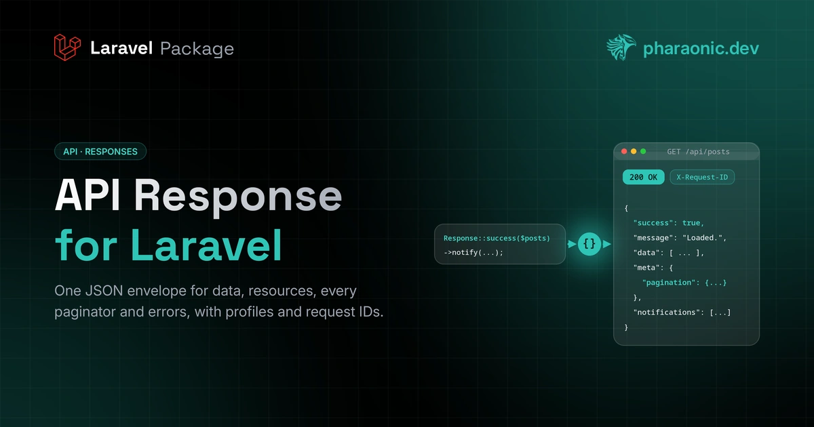

<p align="center"><a href="https://pharaonic.dev/packages/laravel/api-response" target="_blank"></a></p>

<p align="center">
  <a href="https://php.net" target="_blank"></a>
  <a href="https://laravel.com" target="_blank"></a>
  
  
  <br>
  <a href="https://packagist.org/packages/Pharaonic/laravel-api-response" target="_blank"></a>
  <a href="https://packagist.org/packages/pharaonic/laravel-api-response" target="_blank"></a>
  <a href="https://packagist.org/packages/pharaonic/laravel-api-response" target="_blank"></a>
  <a href="https://pharaonic.dev/packages/laravel/api-response#ai-ready" target="_blank"></a>
</p>

<h3 align="center">One consistent envelope for Laravel API responses: success and error responses, resources and every paginator, with profiles, notifications, request IDs and opt-in exception rendering.</h3>
<br>

## Installation

```bash
composer require pharaonic/laravel-api-response
```

The service provider is registered automatically. Publish the configuration when you need to change it:

```bash
php artisan vendor:publish --tag=api-response-config
```

Messages follow the application locale (English and Arabic included). Publish them to change a line or add a language:

```bash
php artisan vendor:publish --tag=api-response-translations
```

## Usage

```php
use App\Http\Resources\PostResource;
use App\Models\Post;
use Pharaonic\Laravel\ApiResponse\Response;

class PostController
{
    public function index()
    {
        return Response::success(PostResource::collection(Post::query()->paginate(15)))
            ->message('Posts retrieved.')
            ->notify('Posts loaded.', 'success');
    }

    public function show($id)
    {
        return Response::error('Post not found.', 404);
    }
}
```

## Documentation

Full documentation: [Laravel API Response Documentation](https://pharaonic.dev/packages/laravel/api-response).

## Support & Security

See [SUPPORT.md](SUPPORT.md) and [SECURITY.md](SECURITY.md). Contributions are welcome; see [CONTRIBUTING.md](CONTRIBUTING.md).

## License

MIT. See [LICENSE](LICENSE).
